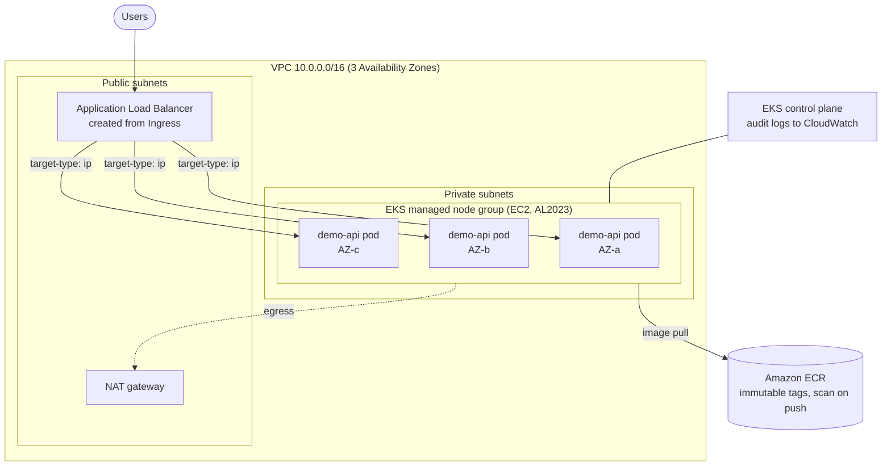

# AWS EC2-to-EKS Re-platforming

[](https://github.com/Lifeofdrew2/aws-eks-platform/actions/workflows/validate.yml)

Re-platforming a VM-hosted web service onto **Amazon EKS** with **Terraform**:
a multi-AZ VPC, an EKS cluster running on EC2 managed nodes, an ECR image
registry, and a hardened Kubernetes deployment exposed through an
Application Load Balancer.

**Technologies:** AWS · Terraform · Amazon EC2 · Amazon EKS · Amazon ECR · VPC · Docker · Kubernetes

> **About this repository.** This is an independent reference implementation
> written from scratch to demonstrate the engineering approach used on
> production re-platforming work. It uses a synthetic sample application and
> contains no client code, configuration or data.

---

## Architecture



| Layer | What is provisioned | Where |
|---|---|---|
| Network | VPC, 3 public + 3 private subnets, NAT, VPC flow logs | `terraform/vpc.tf` |
| Compute | EKS 1.33 control plane, EC2 managed node group (AL2023, IMDSv2 only) | `terraform/eks.tf` |
| Registry | ECR repository: immutable tags, scan on push, KMS encryption, lifecycle policy | `terraform/ecr.tf` |
| Cluster add-ons | VPC CNI (with NetworkPolicy), CoreDNS, kube-proxy, Pod Identity agent, AWS Load Balancer Controller, metrics-server | `terraform/eks.tf`, `terraform/addons.tf` |
| Workload | Deployment, Service, Ingress (ALB), HPA, PDB, NetworkPolicy | `kubernetes/` |
| Application | FastAPI service with health checks and Prometheus metrics | `app/` |

## From EC2 to EKS

The [`legacy/`](legacy/) folder shows the "before" state: EC2 instances that
built themselves at boot with a `user-data.sh` script and ran the app under
systemd. The table there compares each concern (packaging, deploys, scaling,
recovery) before and after, and lists the migration steps.

## High availability

- **3 AZs**: subnets, nodes and pods are spread across three Availability Zones.
- **Zone-aware scheduling**: `topologySpreadConstraints` keep replicas balanced across zones.
- **Zero-downtime rollouts**: `maxUnavailable: 0`, readiness probes and a `preStop` delay let the ALB drain connections.
- **Disruption budget**: a PDB keeps at least 2 pods up during node upgrades.
- **Autoscaling**: HPA scales pods on CPU; the node group scales between `min_size` and `max_size`.

## Quick start

Prerequisites: AWS account, AWS CLI v2, Terraform ≥ 1.6, kubectl, kustomize, Docker, jq.

```bash
# 1. Configure
cp terraform/terraform.tfvars.example terraform/terraform.tfvars
#    set api_allowed_cidrs to your public IP (curl -s https://checkip.amazonaws.com)

# 2. Provision the VPC, EKS cluster and ECR (about 15-20 minutes)
terraform -chdir=terraform init
terraform -chdir=terraform apply

# 3. Build, push and deploy the app
./scripts/deploy.sh

# 4. Test through the load balancer
curl http://$(kubectl -n demo get ingress demo-api -o jsonpath='{.status.loadBalancer.ingress[0].hostname}')/api/orders

# 5. Tear everything down when finished (important - EKS bills by the hour)
./scripts/teardown.sh
```

Without an AWS account you can still run the checks: `make test lint validate`.

## Repository layout

```
├── app/                 Sample FastAPI service, tests and Dockerfile
├── terraform/           VPC, EKS, ECR and cluster add-ons
├── kubernetes/          Deployment, Service, Ingress, HPA, PDB, NetworkPolicy (kustomize)
├── legacy/              The EC2 "before" state and migration notes
├── scripts/             deploy.sh and teardown.sh
├── docs/                Design decisions, security, cost and validation results
└── .github/workflows/   CI: tests, image build, terraform validate, manifest checks
```

## Documentation

- [Design decisions](docs/design-decisions.md) – why each choice was made, and the trade-offs
- [Security](docs/security.md) – controls in place and accepted scanner findings
- [Cost and teardown](docs/cost-and-teardown.md) – what this costs per hour and how to avoid surprises
- [Validation](docs/validation.md) – what was tested and the results

## Related repositories

- **eks-cicd-pipeline** – GitHub Actions pipeline that builds, scans and deploys this app to EKS
- **eks-observability-stack** – Prometheus, Grafana and CloudWatch monitoring for this platform
